<div align="center">


[](https://www.linkedin.com/in/rodrigo-moreno-men%C3%A9ndez-31a413296/)
[](mailto:rmmenendez05@gmail.com)


<sub>▼ <b>Click a function key</b> to jump to a section ▼</sub>

<a href="#about"></a>
<a href="#work"></a>
<a href="#stack"></a>
<a href="#stats"></a>
<a href="#play"></a>
<a href="#contact"></a>


</div>

<a name="about"></a>
 TYPE ABOUT.TXT"/>

```console
╔══════════════════════════════════════════════════════════════╗
║  USER ........ Rodrigo Moreno Menéndez                       ║
║  ROLE ........ Computer Science student @ UCJC               ║
║  LOCATION .... Madrid, ES                                    ║
║  STATUS ...... Open to collabs & internships  ● ONLINE       ║
╚══════════════════════════════════════════════════════════════╝
```

> I write code that **solves real problems**: automation, scripting and efficient software.

- 💻 Always leveling up my **software development** skills
- ⚡ Fan of how **scripting** speeds up everyday tasks
- 🤖 Building with **AI agents** using **Spec-Driven Development**
- 🎮 Into **computer games**
- 🏅 Short-term goal: earn **certifications** that back up my technical skills

<a name="work"></a>
 TYPE WORK.LOG"/>

```console
[ JOB_01 ] ══════════════════════════════════════════════════════
  COMPANY ...... Verti
  TYPE ......... Professional internship
  STATUS ....... [ OK ] Completed: real-world software experience
═════════════════════════════════════════════════════════════════
```

<a name="stack"></a>
 DIR /STACK"/>

```console
 Volume in drive C is RMM-86
 Directory of C:\STACK

LANGUAGES    <DIR>    python  java  javascript  c#  c
FRONTEND     <DIR>    react  react-native  nativewind  tailwind  css
BACKEND      <DIR>    spring-boot  flask  fastapi  django
AI_AGENTS    <DIR>    spec-driven-development
DATA         <DIR>    postgresql  sqlite  duckdb  redis
MESSAGING    <DIR>    rabbitmq
CLOUD_DEVOPS <DIR>    aws  docker  ci-cd
AUTOMATION   <DIR>    power-automate
              8 Dir(s)   ∞ bytes free for learning
```

#### 💾 Languages


#### 🖥️ Front-end & Mobile


#### 🔌 Back-end


#### 🤖 AI Agent Frameworks


#### 🗄️ Data & Messaging


#### ☁️ Cloud, DevOps & Automation


<a name="stats"></a>
 RUN STATS.EXE"/>

<div align="center">


</div>

<a name="play"></a>
 PLAY ADVENTURE.EXE"/>

<details>
<summary><b>💾 INSERT DISK &amp; PRESS START</b> &nbsp;<sub>(click to boot the game)</sub></summary>

<br/>

```text
You wake up in a dark room. A beige computer hums in front of you.
The screen reads: "WELCOME, TRAVELER. WHAT DO YOU SEEK?"
```

<details>
<summary><b>[A]</b> 🗂️ "Show me what Rodrigo builds."</summary>

```text
The drive spins... A list of repositories materializes on screen.
```
➡️ **[Open the repositories](https://github.com/rmmenendez05?tab=repositories)** &nbsp;·&nbsp; ⭐ Star something you like, it gives +1 XP.

</details>

<details>
<summary><b>[B]</b> 🤝 "I want to team up / hire him."</summary>

```text
A modem screeches: KSSSHHH-BEEEP-BOOP... CONNECTION ESTABLISHED.
```
➡️ Jump to **[F6 CONTACT](#contact)** and send a message. Rodrigo replies faster than a 56k modem.

</details>

<details>
<summary><b>[C]</b> 🧠 "Tell me a secret."</summary>

```text
The screen flickers. A hidden directory appears: C:\SECRETS\
```

<details>
<summary>📁 <code>SECRET_01.TXT</code></summary>

> Rodrigo would rather spend 2 hours writing a script than 10 minutes doing a task by hand. Twice.

</details>

<details>
<summary>📁 <code>SECRET_02.TXT</code></summary>

> His favorite design pattern? *Write the spec first, then let the agents do the typing.*

</details>

<details>
<summary>🔒 <code>SECRET_03.TXT</code> <sub>(encrypted)</sub></summary>

```text
ENTER PASSWORD: ********
ACCESS GRANTED.
>> Next level unlocked: game dev. Coming soon...
```

</details>

</details>

<details>
<summary><b>[D]</b> 🚪 "Turn off the computer."</summary>

```text
Are you sure? (Y/N) _
...just kidding, you can't escape. Scroll down. ↓
```

</details>

</details>

<a name="goals"></a>
 TYPE GOALS.LOG"/>

```diff
+ [ACTIVE]    Earn certifications to validate my technical skills
+ [BUILDING]  Create automation tools and AI agents that speed up dev workflows
! [QUEUED]    Apply CS knowledge to game dev projects
```

<a name="contact"></a>
 DIAL CONTACT.BBS"/>

<div align="center">

```console
ATDT 555-RODRIGO ..... CONNECT 56000 ..... HANDSHAKE OK
```

[](https://www.linkedin.com/in/rodrigo-moreno-men%C3%A9ndez-31a413296/)
[](mailto:rmmenendez05@gmail.com)



<sub><a href="#about">▲ back to top</a></sub>

</div>
